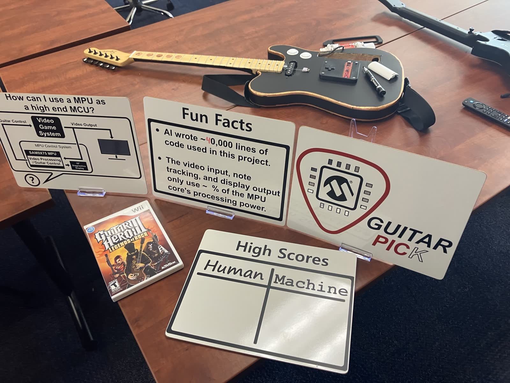
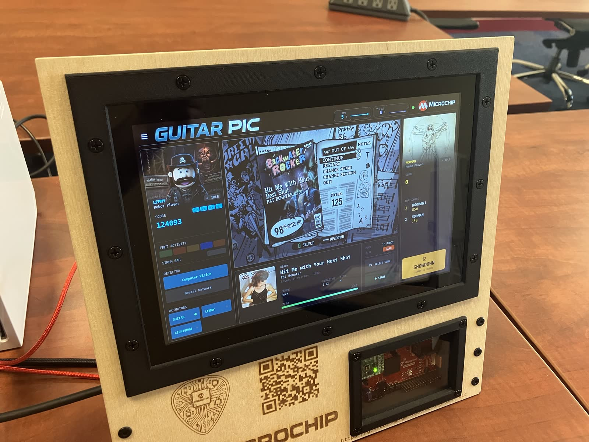
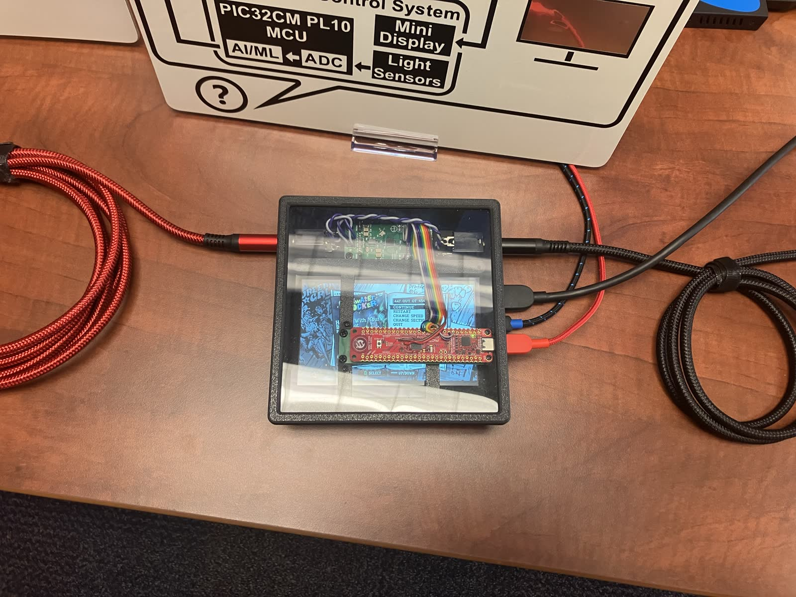
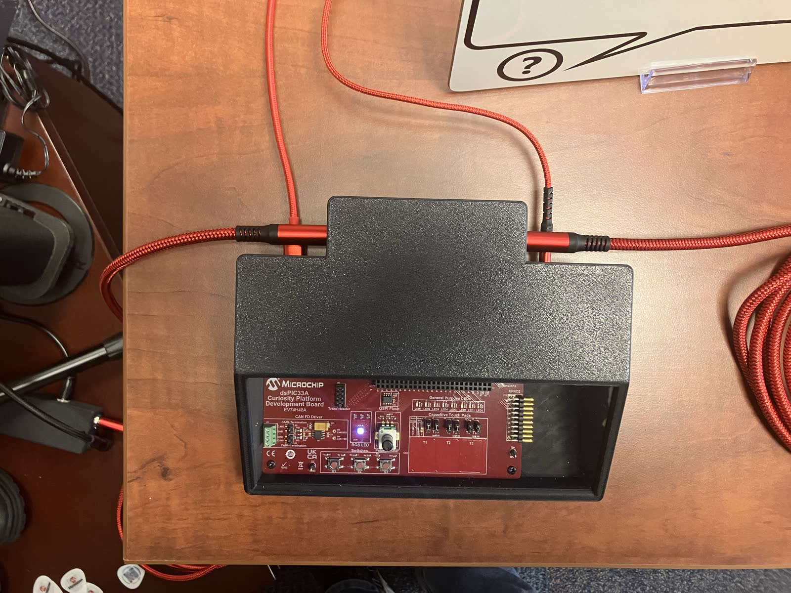
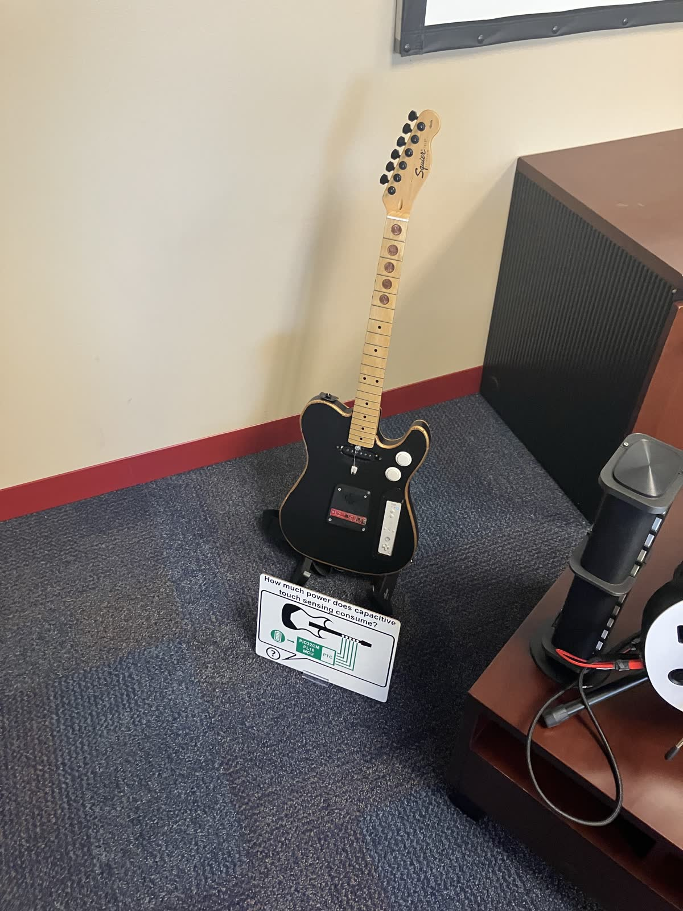

# Booth demo guide: Human vs. Machine

Talking points and operating steps for staff running the Guitar Hero demo at a trade-show
booth. Use the pitch that fits the visitor's time and depth, then point at the hardware as
you talk. Setup is in [SETUP.md](SETUP.md).

Watch these first:
- [SHOWDOWN (robot vs. human)](media/video/showdown.mp4)
- [single-player demo mode](media/video/single-player-demo.mp4)
- [casual 2-player on an easier song](media/video/easier-mode-song.mp4)
- [stopping a song](media/video/stopping-a-song.mp4)

---

## The hook (10 seconds)

> "That's a Microchip control system playing Guitar Hero. Nothing's pre-recorded. It watches
> the game's video, sees the notes, and plays them on a real Wii, with no PC. And every board
> you see here is on one two-wire Ethernet cable. Want to try and beat it?"

## 30-second pitch

> "The board behind the screen is a SAM9X75 microprocessor. It captures the Wii's HDMI video,
> runs computer vision to find every note, times each strum, and sends the button presses
> out to the Wii. It even drives the game's menus by reading the screen.
>
> And it isn't one board, it's a network. Seven nodes on one twisted pair: 10BASE-T1S
> automotive Ethernet. A dsPIC listens to the music and broadcasts the beat. The puppet
> head-bangs to it and the lights flash to it. A tiny PIC32CM with light sensors runs a
> neural network and can play the song itself. No switch, no hub, no IP stack."

---

## Running the demo

Three ways to run it. All of them start from marvin's **dashboard** with GH3 at its main menu
(see [SETUP.md §3](SETUP.md#3-power-up)).

### SHOWDOWN: visitor vs. the machine

The best crowd draw. A fixed song and difficulty, so high scores are comparable.

1. Tap **SHOWDOWN**. Optionally enter the visitor's name; it's only used for the high-score
   list.
2. Choose **client** (attendee) or **Microchip employee**. Only clients appear on the
   TOP SCORES list.
3. marvin starts navigating the menus. Hand the visitor the player guitar, already connected
   as player 2 (second LED lit), and have them:
   - press **down** to move their guitar icon to the **right** side, then **green**;
   - at character select, press **green twice** (pick, then confirm).
4. **Don't press anything else while waiting.** marvin picks the song and difficulty and
   launches it.
5. The robot plays on the **left**, the visitor on the **right**. Tap the video to make it
   bigger; a large audience display helps here. The puppet's guitar buttons light up with
   every note the robot plays.
6. **Let the song finish.** marvin reads both scores off the screen. A good enough score
   goes onto TOP SCORES automatically, with nothing to enter.

Coach new players: press the coloured button **and** strum at the same time as each note
crosses the line. Hold the button down through the long tails.

### Single-player demo: two control systems

The robot plays alone. Use this to explain the hardware.

1. **Select song** → any song, difficulty **hard**, mode **1 player** → **START**.
2. marvin reads each screen to work out where it is, then picks the song and difficulty and
   starts it.
3. **Computer vision** (default): the SAM9X75 watches the video and drives the remote.
4. Switch the detector to **NEURAL NETWORK**. Now the MPU stops controlling the guitar, and
   the PIC32CM PL10 in the fretboard box plays the song. It reads five light sensors, one per fret lane, sitting on
   its own small display.

NEURAL NETWORK is only offered in **1 player, hard**. The model was trained on data from that
mode; other modes would need retraining.

### Casual 2-player

For visitors who want an easier difficulty or a different song. **Scores are not added to
TOP SCORES.** Select song → pick song and difficulty (e.g. easy), mode **2 player** →
**START**. The player-2 steps are the same as SHOWDOWN.

### Stopping a song

**STOP on the dashboard only takes the robot's hands off the controls. The game keeps
running.** To quit a song: Wiimotes → slide to unlock → **+** (pause) → down to **Quit** →
green → confirm Quit → green → down twice to **Main Menu**. Usually it's easier to let the
song finish ([video](media/video/stopping-a-song.mp4)).

---

## Station talking points

Each station has a sign that asks a question. Answer it.

### "How can I use a MPU as a high end MCU?" (marvin)

- The SAM9X75 runs bare metal with MPLAB Harmony + FreeRTOS. No Linux, statically allocated,
  like a big MCU.
- On one chip:
  - MIPI CSI-2 camera input: the Wii's HDMI goes through a bridge into the image sensor
    controller at 60 frames a second.
  - LVDS display: the whole touch dashboard is Legato, composited on the chip's hardware
    layers, with the video on its own overlay.
  - DDR, the CV and the timing.
- It sees notes a few hundred milliseconds before they reach the strike line, so it
  schedules each press to land exactly on the line.
- Press START and it navigates GH3 itself. It recognises about 20 different screens and
  checks each menu step before taking the next one. It reads the score off the screen at
  the end.
- Fun fact (on the sign): the video input, note tracking and display output use only
  ⚠ TBD % of the MPU core.

### "Can Microchip's Arm Cortex-M0+ based MCUs implement AI/ML control systems?" (fretboard)

- The challenge: the lowest-cost, smallest processor that can still play Guitar Hero.
- A PIC32CM PL10 Curiosity Nano sits on a sensor board with five light sensors, one over
  each coloured fret lane of a small HDMI display showing the game.
- Sensors → ADC → an int8 neural net of about 3,000 parameters, running on a **24 MHz
  Cortex-M0+**, 240 times a second.
- It was trained on the SAM9X75's own play: the big chip taught the little one.
- When it plays, it sends its commands straight over the T1S bus, peer-to-peer, with no
  help from the MPU.

### "Should I use 10BASE-T1S on my next design?" (the bus)

The 10BASE-T1S network grew from one replacement cable into the backbone of the whole build.
It's the best story here for engineers. Lead with marvin's **Bus** screen.

**What to show**
- The **Bus** screen during a song: per-node TX/RX rates, heartbeats, CRC/symbol error counts,
  and measured bus utilization. ⚠ TBD: note the typical in-song utilization to quote.
- The **System** screen: one card per node, showing the board, part numbers and QR links.
- The red cables. "That's Ethernet. It just looks like audio cable."

**Talking points**
- **One pair, multidrop, deterministic.** PLCA (802.3cg) gives each node a transmit slot in
  turn, so there are no collisions, no switch and no hub. marvin is the coordinator; an idle
  bus cycle is about 29 µs. The two ends of the chain are terminated.
- **Three Microchip CPU families, one PHY, one driver.** The ARM926 SAM9X75 MPU, the
  Cortex-M0+ PIC32CM PL10 MCUs and the dsPIC33A DSC all use the same LAN8651 MAC-PHY over SPI,
  with the same OPEN Alliance TC6 driver. The LAN8651 does the MAC, PHY and CRC in hardware.
- **It fits a tiny MCU.** On a 64 KB flash / 8 KB RAM PIC32CM, the whole T1S stack is about
  6–10 KB of flash and 1–2 KB of RAM, statically allocated.
- **Raw Ethernet, no IP.** Static addressing (MAC = node id) and one ethertype per purpose:
  commands, heartbeats, beat broadcast, per-node control.
- **Three traffic patterns on one wire:**
  - *Coordinator → node:* marvin sends button presses and per-node control.
  - *Peer-to-peer:* the PIC32CM's neural net commands the remote and the puppet's guitar
    directly, without marvin. The estimated worst case is about 5 ms end to end, and the
    bus adds well under 1 ms of that.
  - *Broadcast:* the dsPIC sends one beat frame about 23 times a second, and the puppet
    and the lights both use it.
- **Self-reporting network.** Every node sends a heartbeat twice a second with its traffic and
  error counts. marvin listens to the whole segment and measures utilization exactly. Each
  node enforces its own on/off gate and reports it back.
- **Bandwidth was never the point.** The whole show uses a small slice of 10 Mbit/s. The win
  is wiring: one pair to every node instead of a star of point-to-point links.
- **Next: PoDL**, power over the same pair. The sink board is in KiCad: 5 V buck plus 3.3 V
  LDOs. Then each node needs one two-wire cable for both power and data.
- **Where this goes:** automotive zonal architectures, industrial sensor and actuator
  networks, building automation. Anywhere CAN or LIN wiring is turning into Ethernet.

Deep reference: [`docs/t1s-podl-link.md`](docs/t1s-podl-link.md).

### dsPIC33A audio control system (beatbox, the puppet and the lights)

- The game audio is split off the HDMI by an audio extractor. Its analog output feeds the
  dsPIC33A.
- The dsPIC33A (200 MHz DSC) samples stereo audio at 48 kHz and runs a 512-point FFT beat
  detector, with headroom to spare. The RGB LED flashes on kicks, and the LED bar is a VU
  meter.
- It broadcasts the beat on the bus. The puppet (PIC32CM PL10 driving two servos) chooses
  its own bursts of head-banging, and the light controller (PIC32CM PL10 driving WS2812
  strips on the speakers) runs its effects. Both run only while a song is playing.

### "How much power does capacitive touch sensing consume?" (cap-touch guitar)

- A player guitar built around a PIC32CM PL10 doing capacitive touch (developed outside
  this repo): tap the coins on the
  neck to fret, and strum by picking the wire with a pick.
- ⚠ TBD: the answer to the sign's question (current draw figures).
- Swapping player guitars takes a battery pull, so pick one per session
  ([SETUP §5](SETUP.md#5-the-capacitive-touch-guitar)).

---

## Deep-dive points by part

| Part | Where | Why it's interesting |
|---|---|---|
| **SAM9X75** (ARM926 MPU) | marvin | MIPI CSI-2 in, LVDS out, and DDR on one MPU. It runs real-time CV + UI on bare-metal Harmony + FreeRTOS. |
| **LAN8651** 10BASE-T1S MAC-PHY | every node | Ethernet on any MCU with SPI, even one with no MAC. |
| **PIC32CM PL10** (Cortex-M0+, 24 MHz, 5 V) | fretboard, lights, puppet, puppet's guitar, cap-touch guitar | One small low-cost MCU, five different jobs: on-device ML, WS2812 driven straight from the 5 V I/O domain, servos, LEDs, capacitive touch. |
| **dsPIC33A** (200 MHz DSC) | beatbox | 48 kHz stereo ADC into a 512-point FFT beat detector. |
| **Legato / MPLAB Harmony** | marvin UI | The whole dashboard is Legato, on the SAM9X75's hardware layers. |

## FAQ

- **Is it cheating, i.e. reading the game data?** No. It only sees the same video you do.
- **How does it press the buttons?** Not mechanically. The presses go over the T1S bus to a
  bridge node that delivers them to the Wii as a wireless controller. The puppet's guitar
  lights up to show what it's pressing. If asked, the bridge is an off-the-shelf Bluetooth
  module, because the Wii only speaks Bluetooth Classic. Answer honestly, then steer back to
  the SAM9X75 and the bus.
- **How good is it?** It hits just about every note. ⚠ TBD: typical scores to quote.
- **Why not a PC?** Version 1 was a PC with a USB capture card and OpenCV. The point is doing
  it embedded, in real time, on parts you can buy.
- **Who wrote the code?** Per the Fun Facts sign, AI wrote about 40,000 lines of it.
- **Can I get the code?** ⚠ TBD: what to say about availability.
- **What is 10BASE-T1S for, really?** Automotive and industrial: many sensors and actuators on
  one pair, replacing CAN/LIN-style harnesses with Ethernet.
- **How far can the bus run, and how many nodes?** The 802.3cg multidrop spec targets at least
  25 m and at least 8 nodes. This build uses 8 PLCA slots (7 used).
- **Why not CAN?** CAN would carry these messages. T1S makes every node a plain Ethernet
  endpoint: standard frames, MAC addresses and tooling, at 10 Mbit/s, on the same pair.

## Don't promise / known quirks

- **STOP doesn't stop the game**, only the robot. Let songs finish, or quit via the Wiimotes
  screen (above).
- **NEURAL NETWORK is 1-player hard only.**
- **Don't press extra buttons** while marvin is navigating menus. It verifies every screen,
  and stray inputs confuse it.
- **The puppet and lights only perform during a song**, and only if enabled under the
  dashboard ACTUATORS.
- **One player-2 guitar at a time.** Swapping needs a battery pull.
