# Packing the demo

How to pack the Human vs. Machine demo into its two road cases, **MARVIN** and **LEMMY**,
for shipping. Each case has a foam **bottom tray** and a foam **top insert** cut to the
parts. Every item has its own cutout. If something doesn't fit flat, it's in the wrong
pocket. Positions below are as seen standing at the **handle side**, with the lid hinged open
away from you, as in the photos.

Unpacking is the same steps in reverse. Then follow [SETUP.md](SETUP.md).

Before packing:
- Power everything off and unplug all cables. Coil each cable loosely; don't wrap it tight
  around the hardware.
- Take marvin's SD card out only if you need its results file. Otherwise leave it in place
  ([SETUP §2.5](SETUP.md#25-marvins-sd-card-before-each-show)).
- Detach each Wii guitar's neck from its body.
- Take the puppet off the tripod and unplug its two servo leads
  ([SETUP §2.4](SETUP.md#24-puppet), in reverse).

---

## MARVIN case: control systems, Wii, guitars

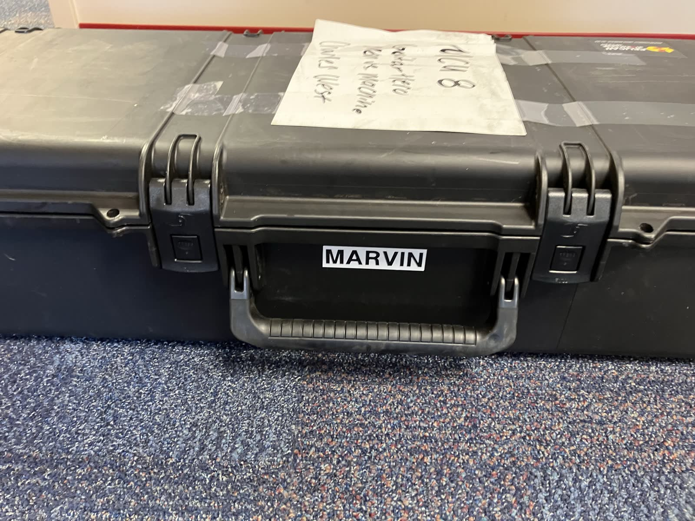

**Contents:**

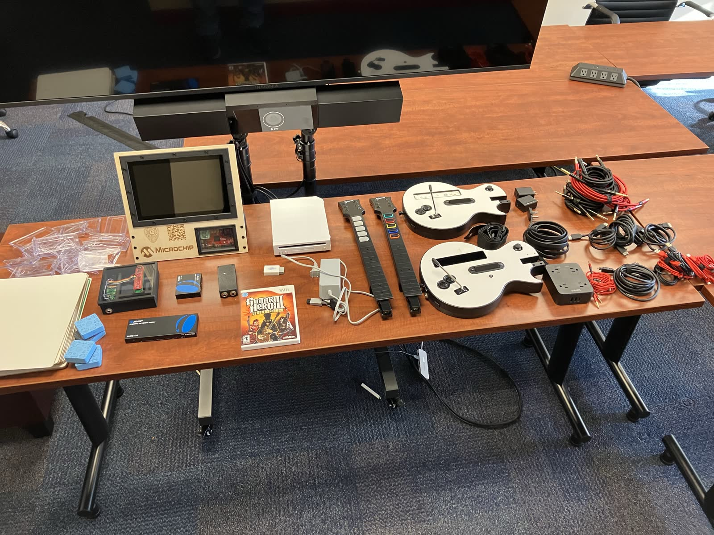

- [ ] marvin (MPU control system with the 10.1″ panel)
- [ ] fretboard node (clear box), plus its small HDMI display
- [ ] computer-controlled remote (small black box)
- [ ] HDMI splitter, HDMI audio extractor, ElectronWarp
- [ ] Wii, Wii power supply, GH3 disc
- [ ] Both Wii Les Paul guitars, bodies and necks separate: the puppet's guitar and the
  player guitar
- [ ] Power hub
- [ ] Cables: red T1S, HDMI, USB
- [ ] Acrylic sign stands, high-score whiteboard + erasers
- [ ] Cleaning cloth (for marvin's screen)

### 1. Bottom tray: guitars, Wii, disc

Lay both guitar bodies face up, with the necks along the front (handle) edge. The **Wii**
goes in the pocket on the left, with the **GH3 disc** (in its case) on top of it and the
small white adapter beside it.

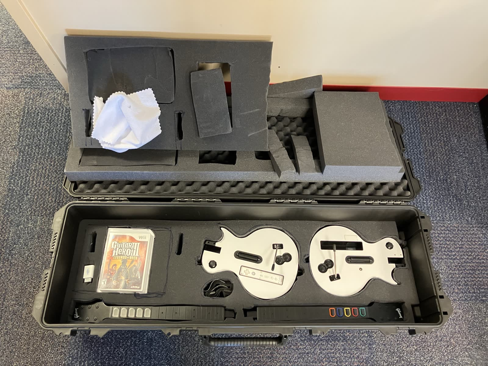

### 2. Middle layer: whiteboard, Wii power, small display

Lay the middle foam layer over the guitars, then fill it:
- the high-score whiteboard in the large pocket, right of centre
- the Wii power supply and the whiteboard erasers in the centre pocket
- the fretboard's small HDMI display in the pocket marked **DISPLAY**, on the left

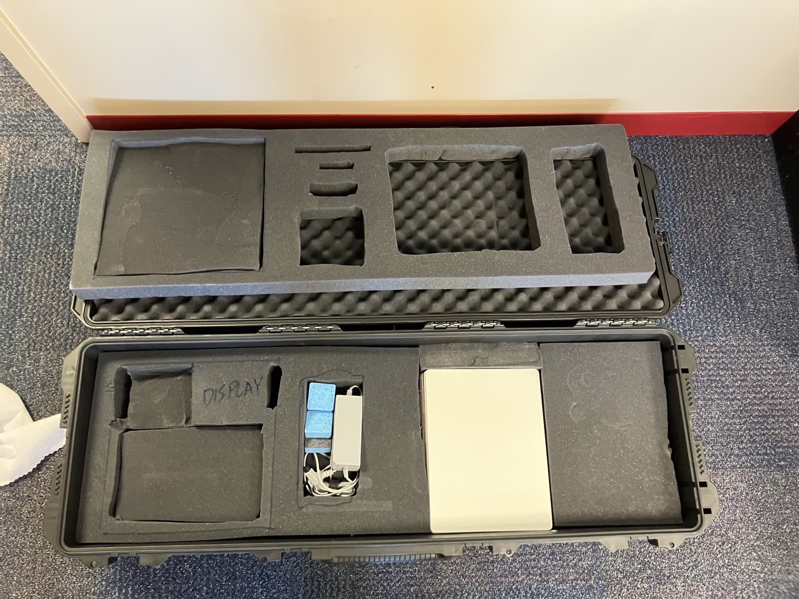

### 3. Top insert: marvin and the electronics

1. **marvin** goes face up in the large pocket on the left. Lay the cloth over the screen,
   then the foam pad on top.
2. The **acrylic sign stands** go in the pocket right of the slim pockets, under the cables.
3. The **power hub** and its cord go in the pocket on the right.
4. **Cables** go in the big pocket right of centre: the red T1S cables and the black HDMI/USB
   cables.
5. The slim pockets in the centre hold the **HDMI splitter**, **audio extractor** and
   **ElectronWarp**; each fits only its own pocket. The **fretboard node** box goes in the
   square pocket behind them.

| | | |
|---|---|---|
| 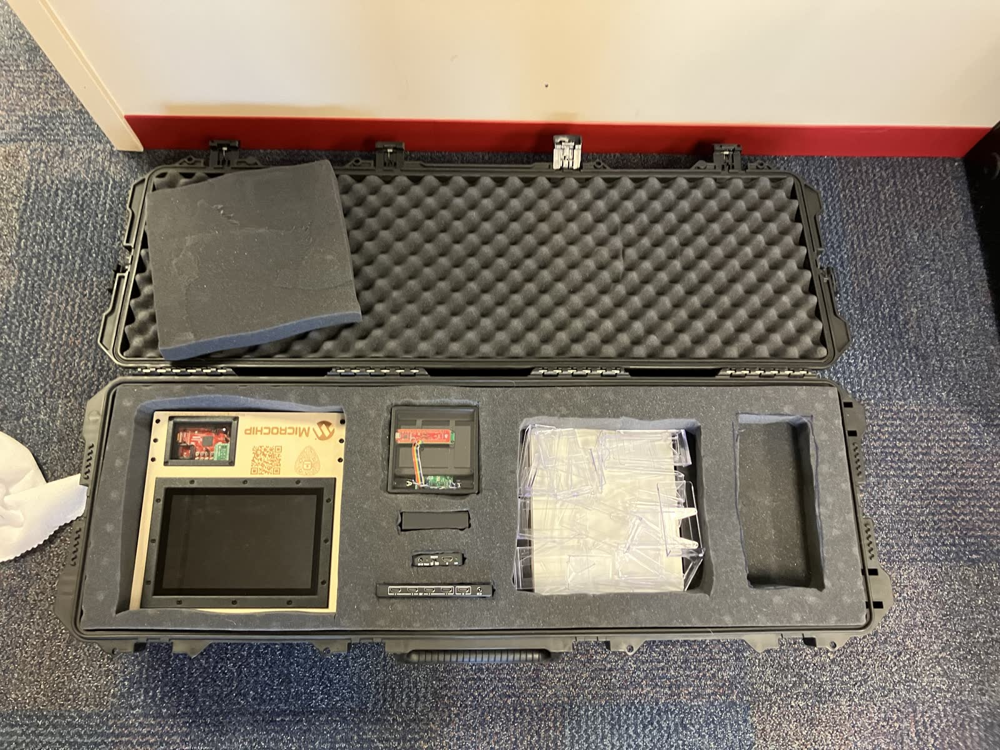 marvin in place | 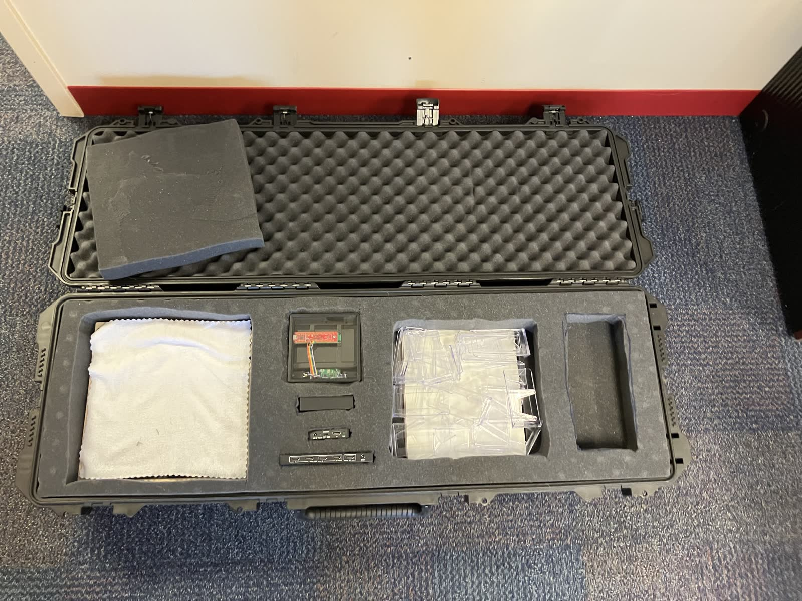 cloth over the screen | 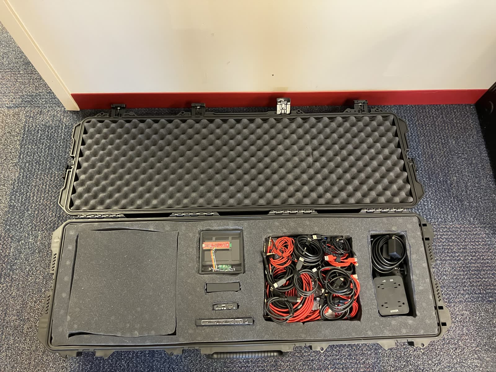 foam pad on, top insert full |

Close and latch. Check the case is labelled **MARVIN**.

---

## LEMMY case: puppet, speaker towers, audio and lights

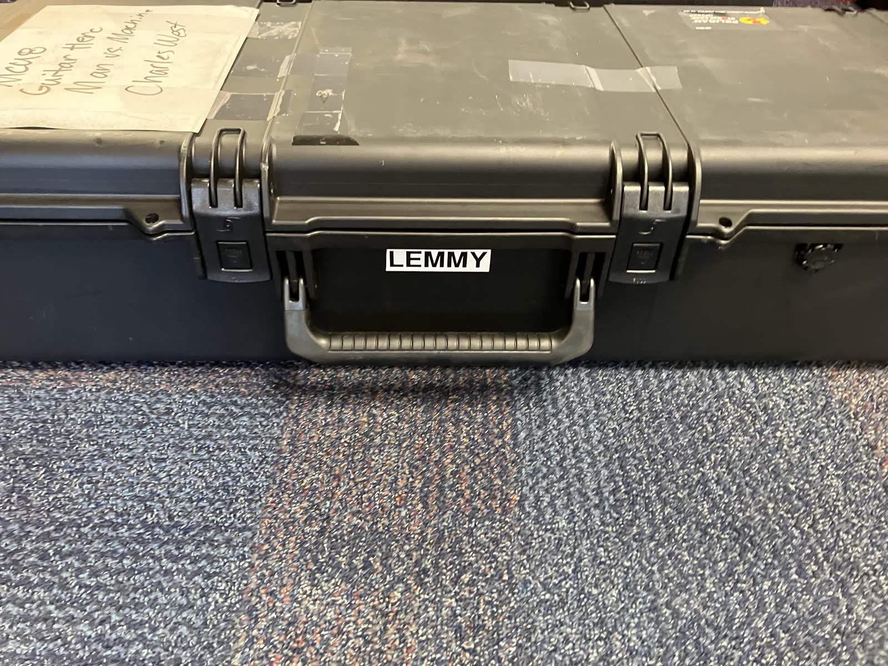

**Contents:**

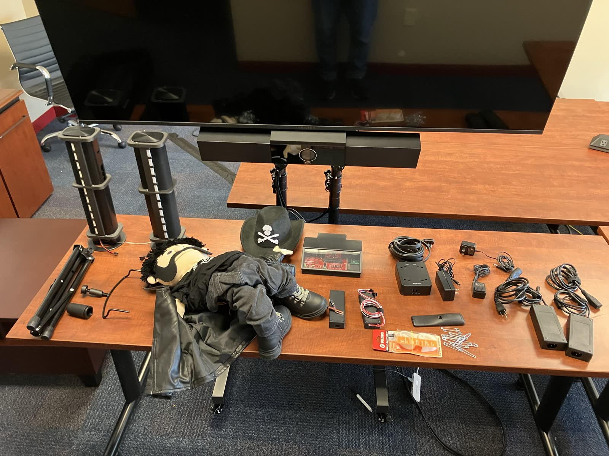

- [ ] Puppet (with jacket) and hat
- [ ] Tripod, puppet pole + locking knob, guitar mounting bracket
- [ ] Two speaker towers (with the light strips)
- [ ] beatbox (dsPIC33A board in its clear tray)
- [ ] Light controller and servo controller (small black boxes)
- [ ] Two identical power bricks, power cords, USB power adapters
- [ ] Power hub
- [ ] Speaker remote
- [ ] Velcro ties, safety pins

### 1. Bottom tray: tripod, towers, puppet, hat

1. Fold the **tripod** into the slim slot along the back (hinge) edge, on the left.
2. The two **speaker towers** go in the long cutouts on the right, light strips facing up.
3. The **hat** goes in the centre slot.
4. Lay the **puppet** face up in the large cutout on the left, with the jacket on.
5. Small cables go in the other slim slot, behind the puppet.
6. Lay the foam covers over the towers.

| | | |
|---|---|---|
| 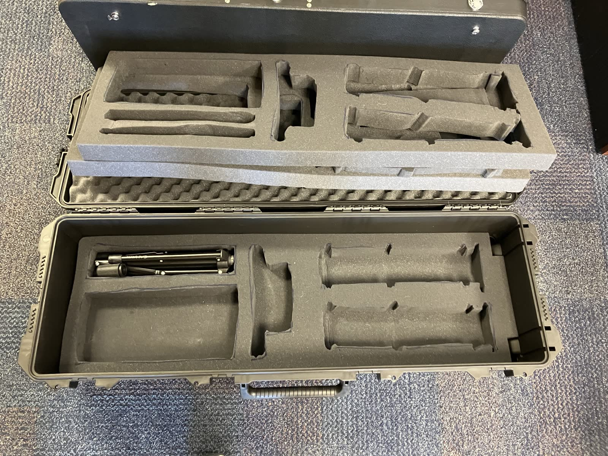 tripod in its slot | 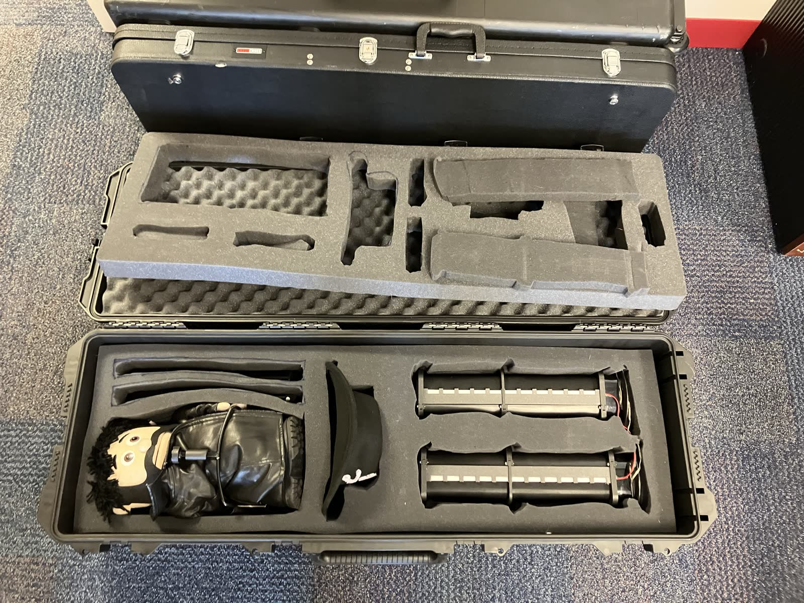 towers, hat, puppet | 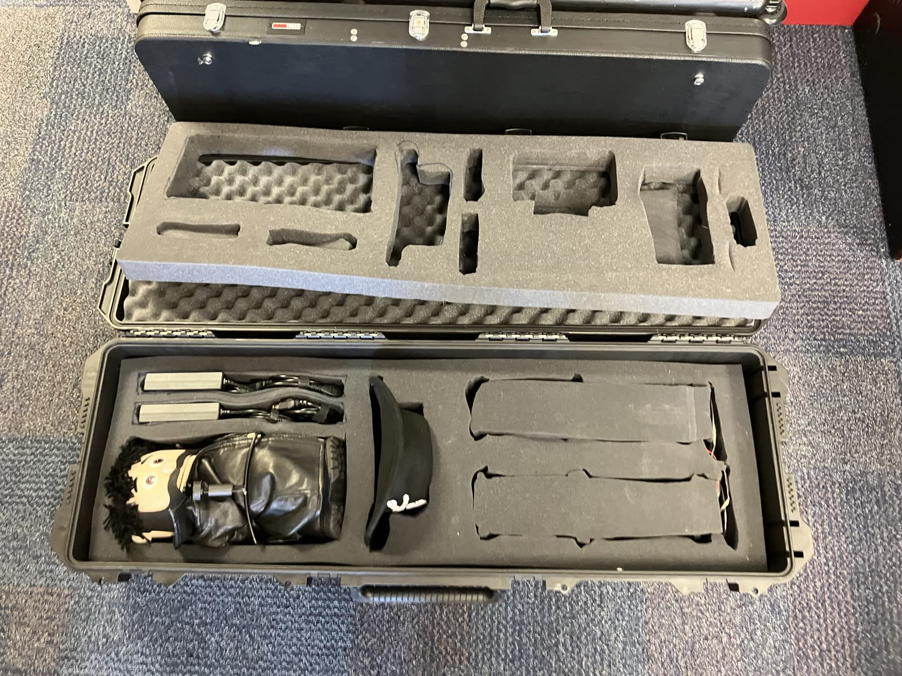 tower covers on |

### 2. Top insert: electronics

Lay the top insert in place; the puppet and hat show through its openings. Then fill it:
- the **power hub** and its cord in the pockets on the right
- **beatbox** in its tray, board up
- the **servo controller** and **light controller** in the two slim slots
- **Velcro ties** and **safety pins** beside the puppet
- **power bricks, cords and the speaker remote** in the remaining pockets

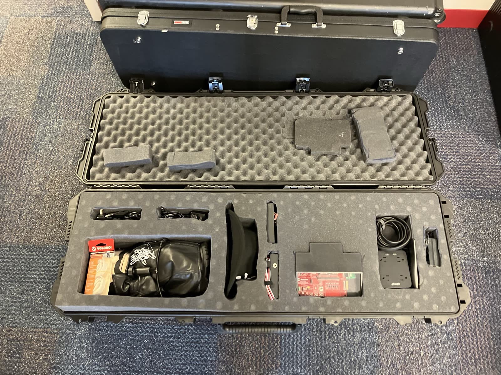

Close and latch. Check the case is labelled **LEMMY**.

---

## Not in these two cases

- **Capacitive-touch guitar:** ships separately.
- **Large audience display:** not shipped. If you want one, it has to be provided on site;
  it connects to the HDMI splitter's spare output ([SETUP §2.2](SETUP.md#22-video-and-audio)).
