# Booth setup

Checklist for assembling the **Human vs. Machine** Guitar Hero demo at a venue. Every board
arrives already built and flashed. This guide covers unpacking, cabling, powering up, and
checking that everything is alive. Reflashing is in the [appendix](#appendix-reflashing).
The road cases and how to pack them are in [PACKING.md](PACKING.md).

Videos of each step are in [`media/video/`](media/video/):
- [system walkthrough](media/video/system-walkthrough.mp4) (every cable, end to end)
- [power-up](media/video/power-up.mp4)
- [puppet setup](media/video/puppet-setup.mp4)

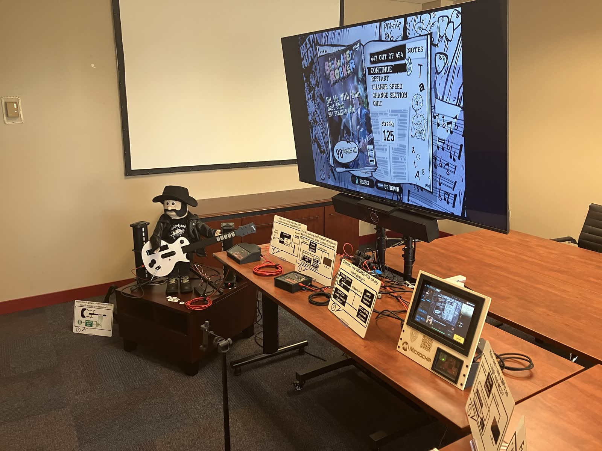

---

## 1. What's in the kit

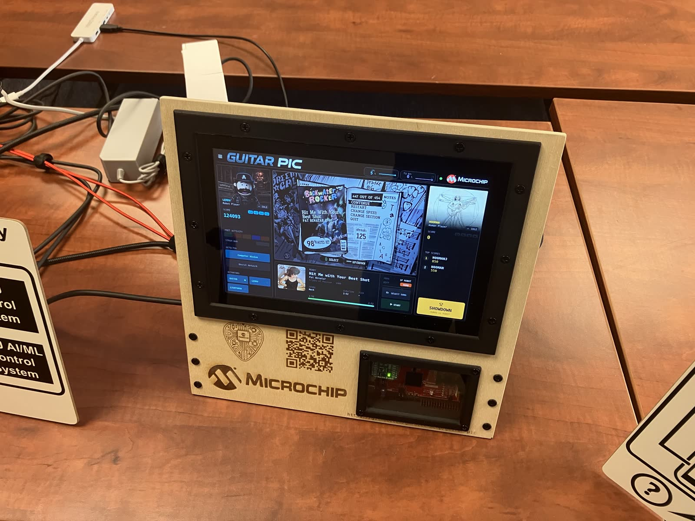

The 10BASE-T1S bus runs through every station, carried on the **red braided audio-style
cables**. It's a real Ethernet network, despite the audio connectors.

| Station | What it is | Needs |
|---|---|---|
| **MPU control system** (marvin) | SAM9X75 board behind the 10.1″ touch panel | USB-C power (the port labelled *power*), HDMI in, T1S out |
| **Computer-controlled remote** | the small black box that talks to the Wii | USB power, T1S in/out |
| **MCU AI/ML control system** (fretboard) | PIC32CM PL10 Curiosity Nano, five light sensors (one per fret lane), a small HDMI display | power for the display *and* the Curiosity Nano, HDMI in, T1S in/out |
| **dsPIC33A audio control system** (beatbox) | dsPIC33A Curiosity board | power, analog audio in, T1S in/out |
| **Light controller** (lightshow) | black box by the puppet | power brick #1, two LED leads to the speaker lights, T1S in/out |
| **Servo controller** (lemmy) | behind the puppet, on the tripod | power brick #2, two servo leads to the puppet's head, T1S in/out |
| **Puppet's guitar** (guitar node) | white Les Paul the puppet holds; its buttons light up as the robot plays | power, T1S in (end of the bus) |

Also in the kit:
- [ ] Wii, Wii power supply, **ElectronWarp** HDMI adapter, **Guitar Hero III** disc
- [ ] **OREI 1×4 HDMI splitter** + **OREI HDMI audio extractor**
- [ ] Two speaker towers (with the light strips) + their AC adapter + **speaker remote**
- [ ] Player guitars: the standard Wii guitar (Wiimote inside) and the
  [capacitive-touch guitar](#5-the-capacitive-touch-guitar) (ships separately), plus picks
- [ ] Puppet, tripod, guitar mounting bracket, hat, Velcro ties, safety pins
- [ ] Two identical power bricks (light controller, servo controller), power strip
- [ ] Optional: a large display for the audience. **Not shipped; arrange one on site.**
- [ ] Booth signs and the Human / Machine high-score whiteboard

## 2. Cabling

### 2.1 The T1S bus

The bus is a daisy chain: each station has a T1S cable **in** and a T1S cable **out** to the
next. The two ends, **marvin** and the **puppet's guitar**, carry the bus termination. Both
must be connected or the bus won't work. The middle stations can go in any order, and the
bus still runs if one is missing. The recommended order is:

```
marvin → remote → fretboard → beatbox → light controller → servo controller → puppet's guitar
(end)                                                                         (end)
```

The guitar's T1S/power connector takes only one cable, which is packed with the kit.

| | |
|---|---|
| 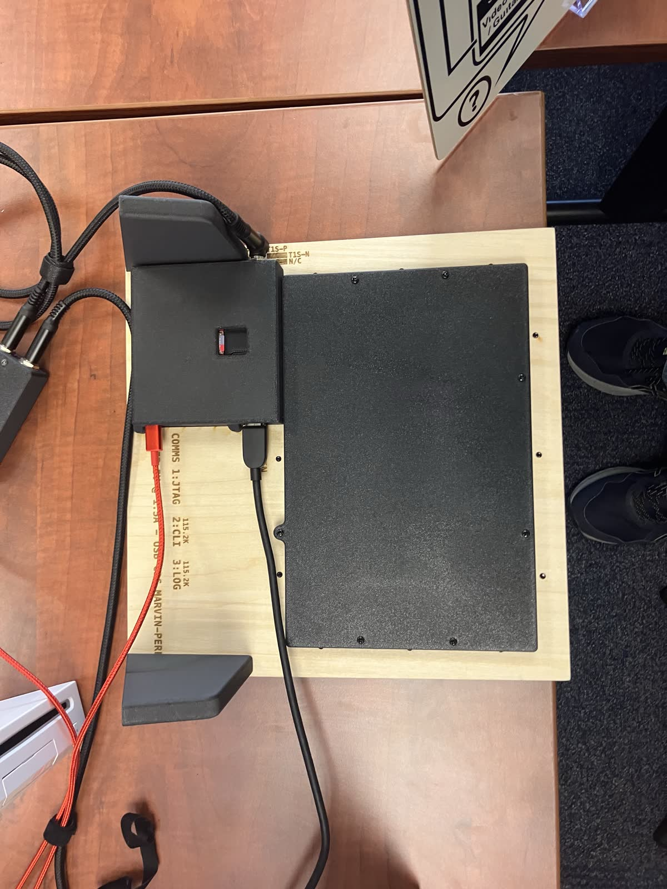 marvin: power, HDMI, T1S | 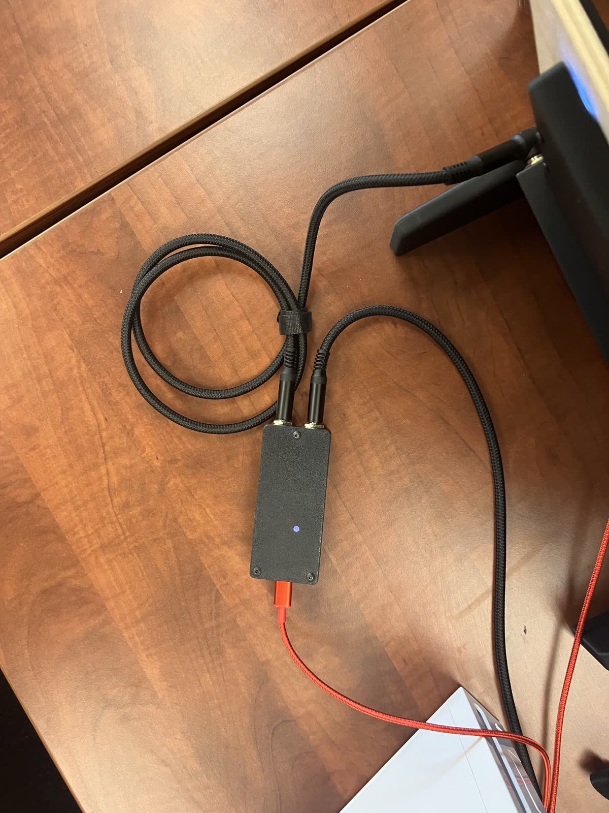 computer-controlled remote |
| 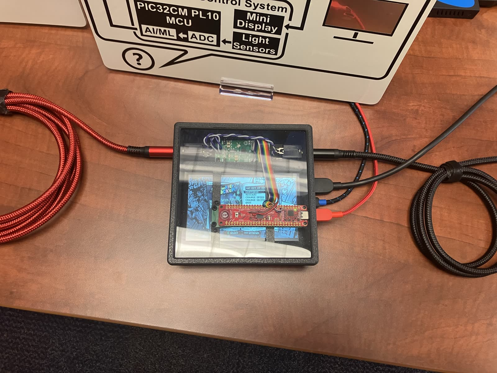 fretboard: HDMI display + Curiosity Nano | 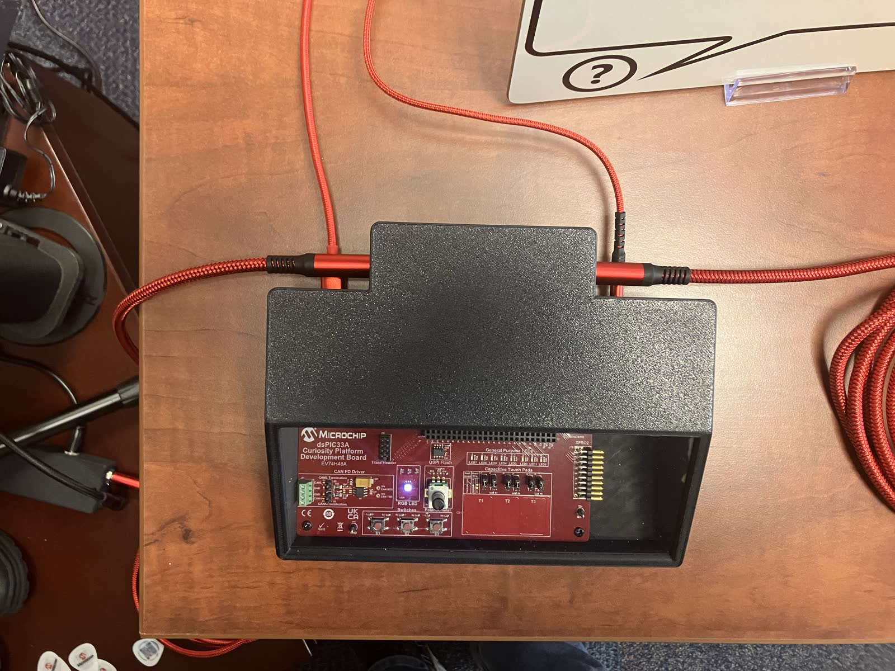 beatbox: T1S in/out, audio in |
| 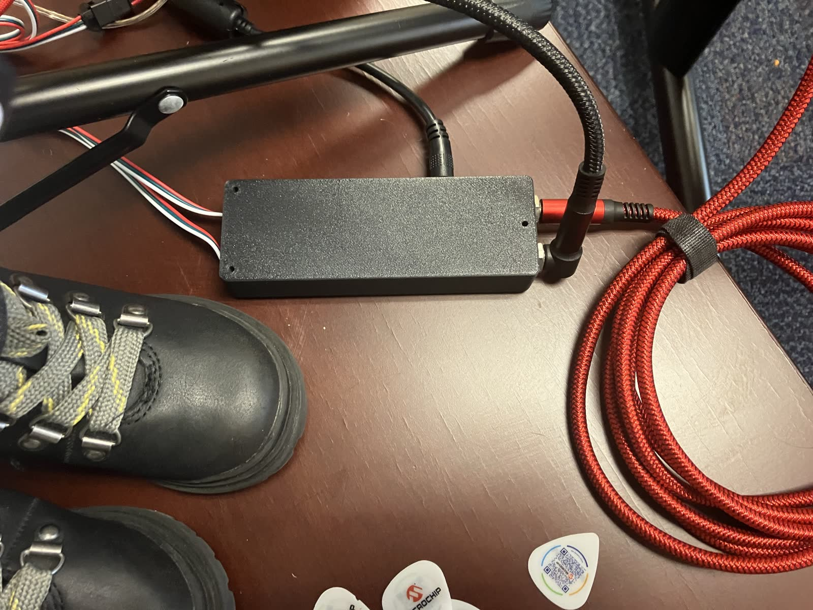 light controller | 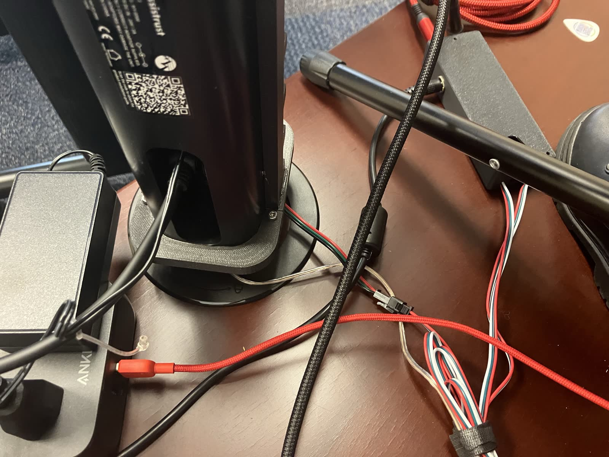 speaker light leads |

### 2.2 Video and audio

```
Wii ─► ElectronWarp ─► HDMI splitter ─┬─► marvin
                                      ├─► fretboard's small display
                                      ├─► HDMI audio extractor ─┬─ analog ──► beatbox
                                      │                         └─ optical ─► speakers
                                      └─► big display (optional)
```

| | |
|---|---|
| 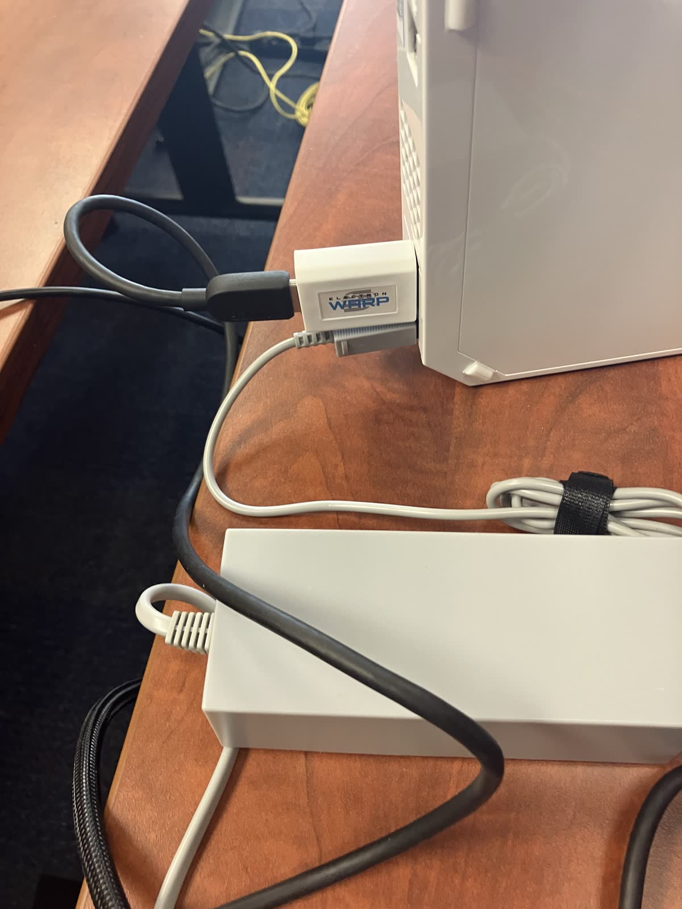 Wii → ElectronWarp | 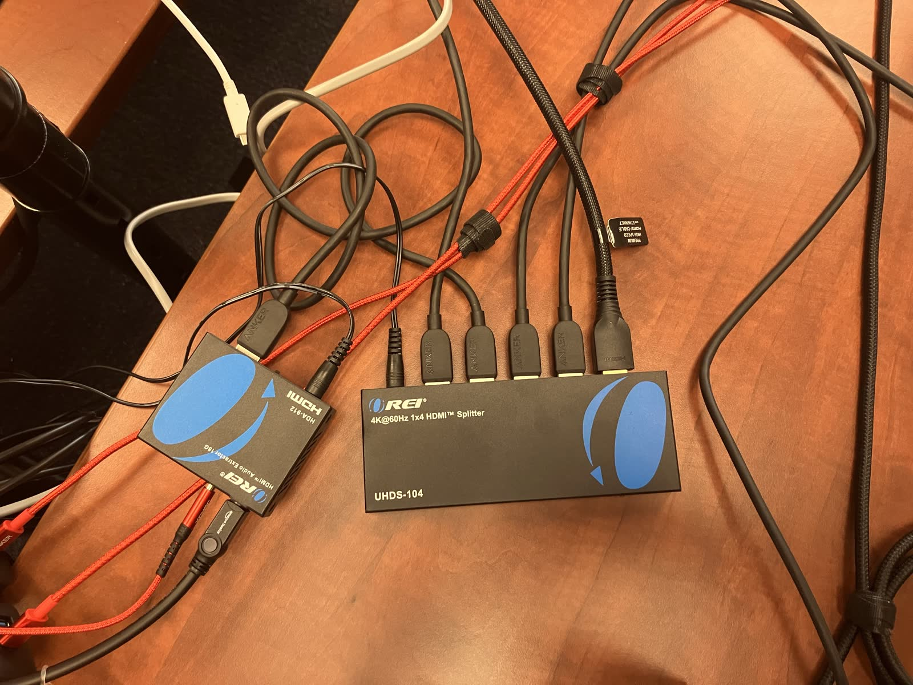 splitter + audio extractor |

### 2.3 Power

- marvin: its USB-C *power* port to the supply. The other USB-C port is not power.
- Remote: USB power.
- fretboard: two power leads, one for the HDMI display and one for the Curiosity Nano.
- beatbox: power.
- Light controller and servo controller: one of the two identical power bricks each.
- Puppet's guitar: power, on the same connector as T1S.
- Speakers: their own AC adapter.

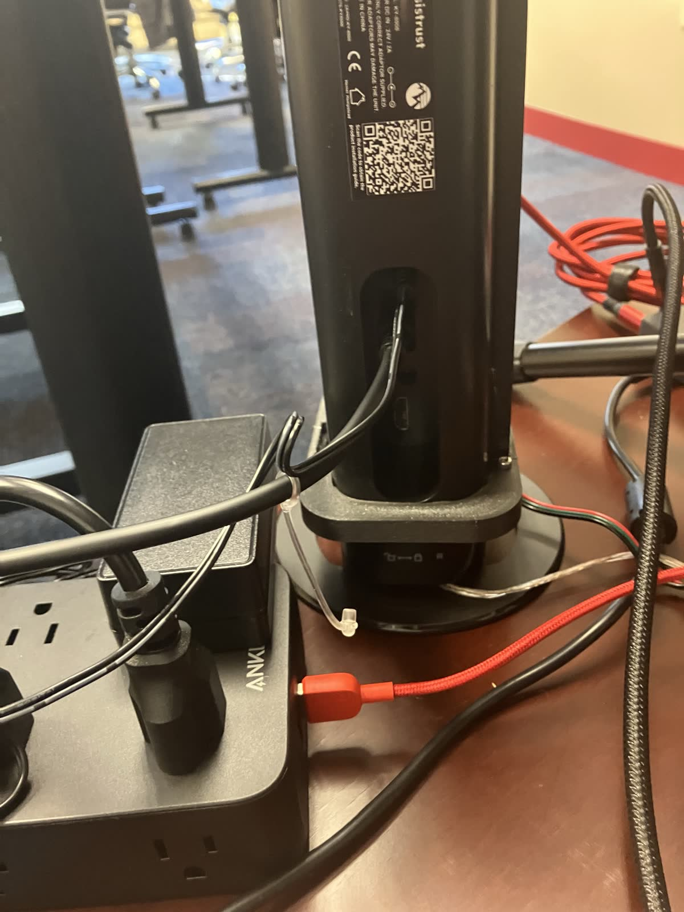

### 2.4 Puppet

Follow the [puppet setup video](media/video/puppet-setup.mp4).

1. Stand up the tripod. Velcro the servo controller to a tripod leg so its leads reach the
   puppet.
2. Screw on the mounting bracket **with the guitar holders toward the top**. Holders at the
   bottom is upside down.
3. Slide the pole inside the puppet's back into the tripod, and twist to lock.
4. Hang the guitar by the holes on its back onto the bracket's metal slots. Velcro the
   puppet's hands to the guitar. Pin the hat on, if you like.
5. Connect the two servo leads at the back. The **brown-taped** lead goes to the brown-taped
   connector, and the untaped lead to the untaped one. Match the wire colours.

| | |
|---|---|
| 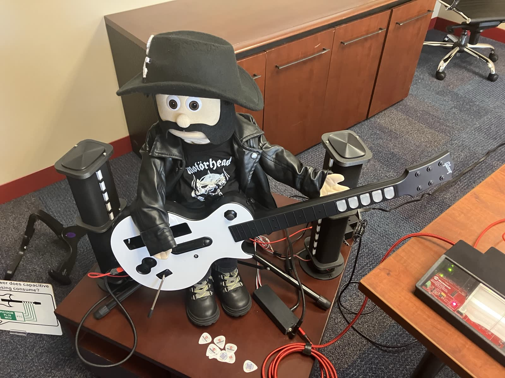 | 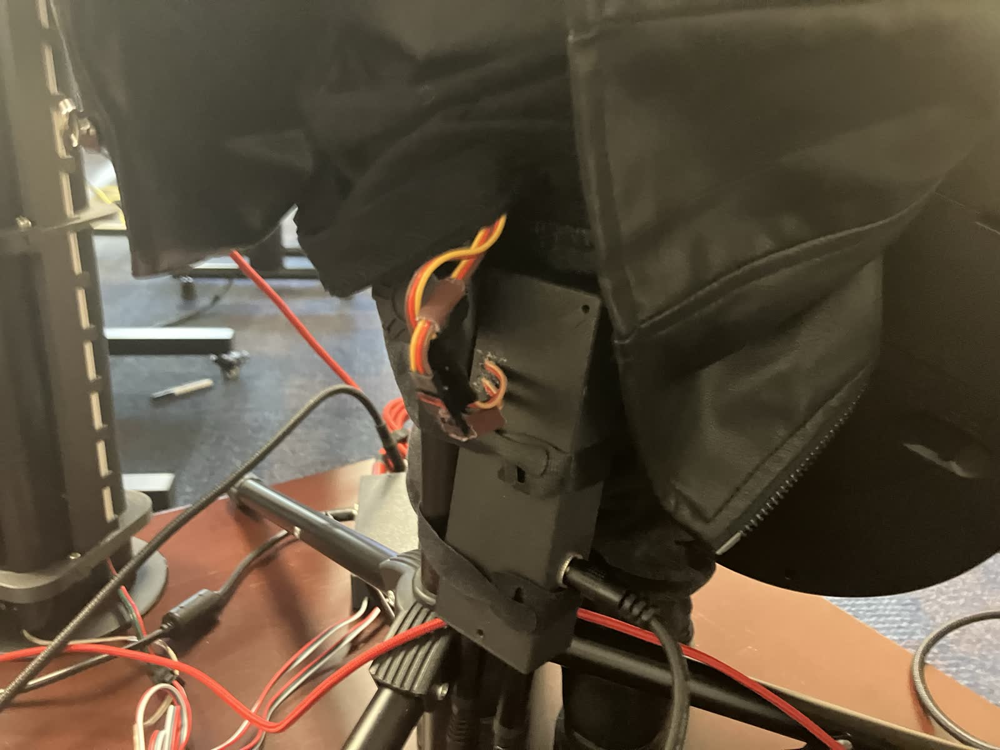 |

### 2.5 marvin's SD card (before each show)

marvin's microSD card holds the song list, album art, the SHOWDOWN setup and the high
scores. Do these on a PC **with marvin powered off**, then put the card back before power-up.

The card is reached through the small opening in the black electronics box on the back of
marvin (yellow box below):

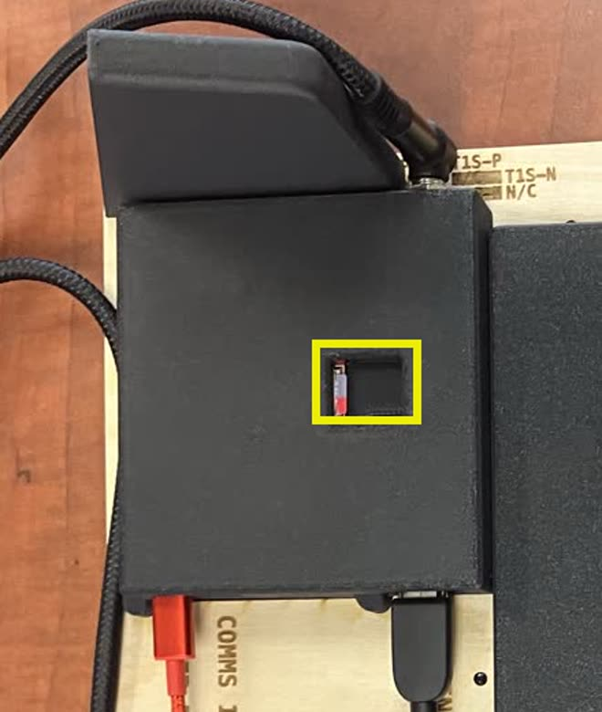

**Only touch the two files below. Leave everything else on the card exactly as it is.**
The other folders hold what gameplay and the dashboard need (song list, album art, node
photos). Don't delete, rename or reformat them.

```
games/gh3-wii/
  showdown.cfg       ← EDIT: SHOWDOWN song + difficulty
  songs.csv          leave: song list (look up song numbers here, don't change it)
  art/               leave: album art
system/              leave: System-screen node photos
players/
  results.csv        ← RENAME to clear high scores (keep the players/ folder)
health/              leave: marvin's health logs
```

If the card is ever lost or corrupted, recreate it by copying `games/` and `system/` from
[`firmware/marvin/data/`](firmware/marvin/data/) to the root of a FAT32 card.

**Clear the high scores.** Rename just the file `players/results.csv` to something like
`results-<show>-<date>.csv` (or move that one file off the card). Leave the `players/`
folder in place. marvin starts a fresh file on the next result. Renaming keeps the old
show's results for later. Also wipe the high-score whiteboard.

**Change the SHOWDOWN song or difficulty.** Edit `showdown.cfg`:

```
song       = main,4        # <main|bonus>,<number>: the number from songs.csv
difficulty = hard          # easy | medium | hard | expert
```

The current setting is song `main,4` ("Rock and Roll All Nite") on hard. The TOP SCORES
board belongs to one song *and* difficulty, so a new SHOWDOWN starts on an empty board
even without clearing. If the file has a mistake, the **SHOWDOWN button disappears** from
the dashboard. Power off, fix the file, and boot again. marvin's **Activity log**
screen shows a `SHDN:` line saying what was wrong.

**Check it** after power-up, on marvin's console:
- `showdown` prints the loaded match; `showdown reload` re-reads the file.
- `scores main 4 hard` lists the top scores for that song and difficulty.

Format detail: [`firmware/marvin/data/README.md`](firmware/marvin/data/README.md).

## 3. Power-up

Follow the [power-up video](media/video/power-up.mp4).

1. **Power on the Wii.** marvin's display comes up a few seconds later.
2. **Connect the robot as player 1.** On marvin, open **Wiimotes**, slide to unlock, and
   press **up**. A hand with a **1** must appear on screen. If it doesn't, the robot isn't
   player 1. Power everything off, including the player guitars, and boot again so the robot
   connects first.
3. **Insert the GH3 disc**, label side as shown in the video. Wait until the disc channel
   shows *Guitar Hero III*, then press up again to confirm player 1 is still connected.

   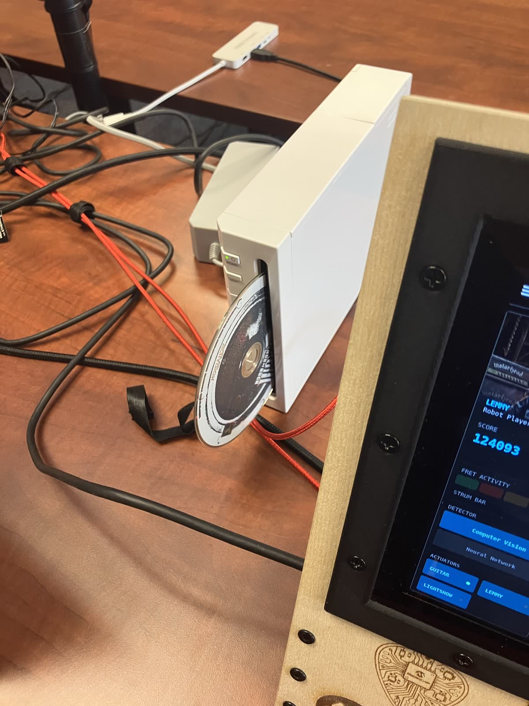

4. **Connect the player guitar as player 2.** Press the **2** button on its Wiimote; the
   *second* LED lights. Move the joystick and a red **2** hand should follow.
5. **Launch GH3** with the player guitar: put the hand on the disc channel, press green,
   then on **Start**, press green.
6. **Check the robot's controller.** GH3 drops the robot's controller when the game boots.
   On marvin's Wiimotes screen, press **green**. It should skip the intro videos.
   - If it doesn't, press **RECONNECT**, then green.
   - Still nothing: unplug the **remote**'s power, plug it back in, press **RECONNECT**,
     then green.
   - Gameplay won't work until green skips the videos.
7. Skip through to the GH3 main menu, past "press green / ready to rock". Go back to
   marvin's **dashboard**. The booth is ready.
8. **Speakers:** with the speaker remote, press power, then **OPT**. The light must be
   **green** (optical). Blue means Bluetooth mode. Set the volume with the remote.

## 4. Check it's alive

| Check | Where | Expect |
|---|---|---|
| Live video | marvin dashboard | Wii picture in the video window; tap it for fullscreen |
| All nodes present | Navigation drawer → **Bus** | Six followers, with rising TX/RX counts and no CRC/symbol errors |
| Robot is player 1 | Wiimotes screen | Green skips menus / videos |
| Beat input | beatbox board | RGB LED flashes on kicks; the LED0–7 VU meter moves with the music |
| Fretboard display | fretboard box | The small display shows the game |

Then run one song (see [DEMO.md](DEMO.md)). The puppet bobs its head now and then, and the
speaker lights follow the music, but only while a song is playing.

## 5. The capacitive-touch guitar

A second player guitar, built on a PIC32CM PL10 with capacitive touch. Coins on the neck are
the fret buttons; strum by picking the wire across the body. It has a Wiimote inside, which
connects as player 2 like the standard guitar. Its firmware is developed outside this repo;
this section covers only running it at the booth.

| | |
|---|---|
| 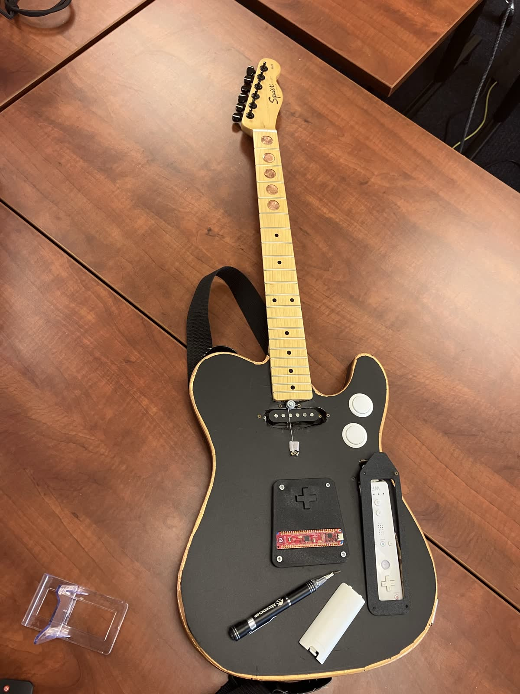 | 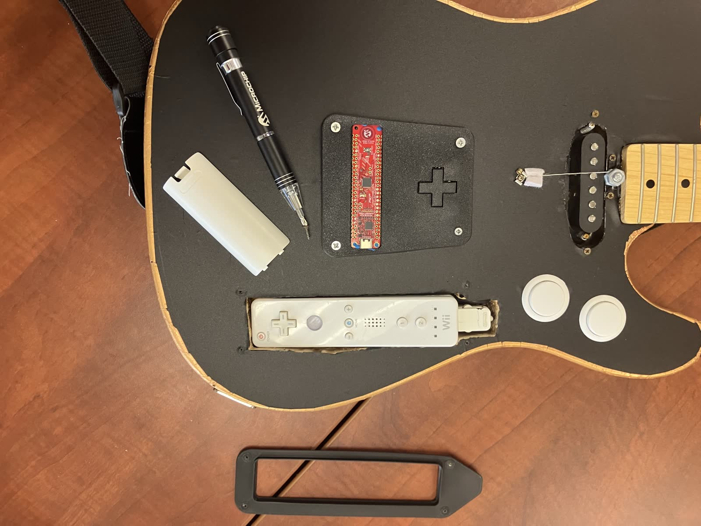 |
| 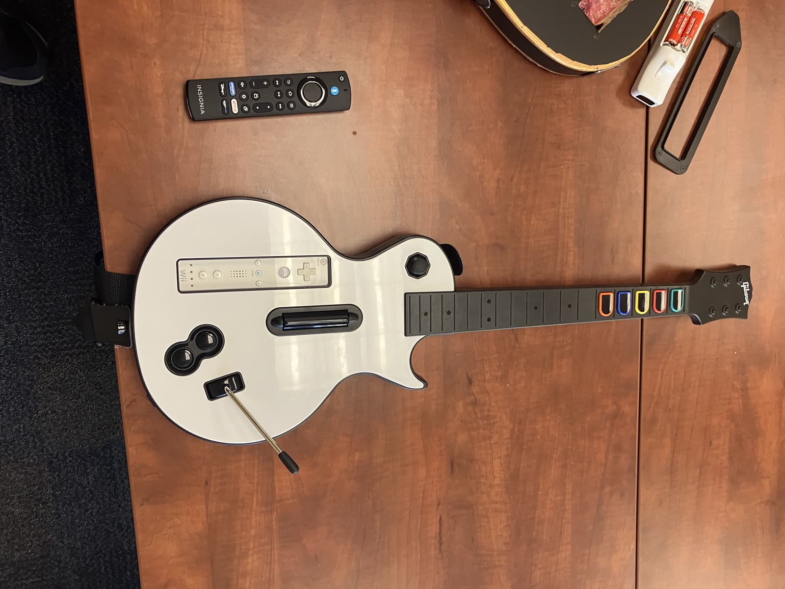 standard Wii guitar | 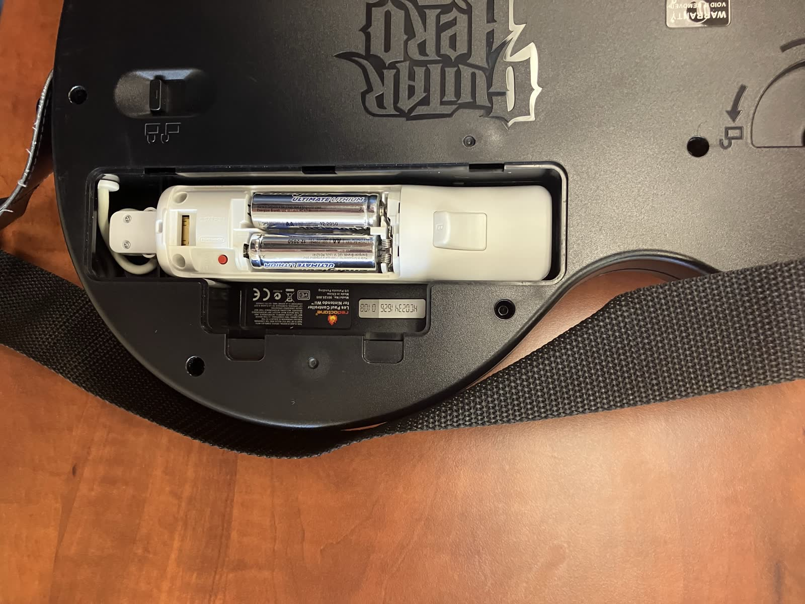 its Wiimote + batteries |
| 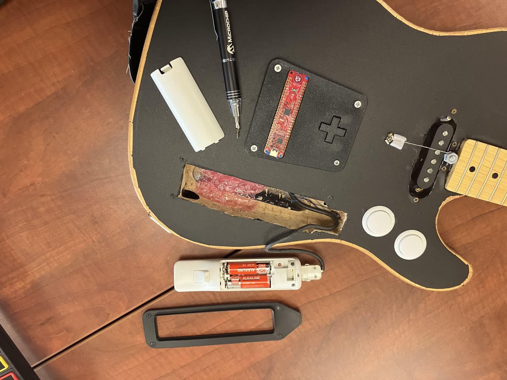 cap-touch Wiimote removed | |

**Swapping player guitars is slow.** Only one guitar can be player 2. To switch, power off
the current guitar's Wiimote:
- **Standard guitar:** remove the back cover and pull one battery.
- **Cap-touch guitar:** unscrew the panel, pop the Wiimote out, and remove a battery.

Then press **2** on the other guitar; its second LED lights. Pick one guitar for a session
rather than switching every game. Videos: [swapping](media/video/captouch-guitar-1.mp4),
[playing](media/video/captouch-guitar-2.mp4).

## 6. Troubleshooting

| Symptom | Fix |
|---|---|
| Nothing on the bus / nodes missing everywhere | One of the bus ends (marvin or the puppet's guitar) is disconnected. Both are terminated and both are required. |
| One node missing from **Bus** | Check its T1S in/out and power. Run `nodes` on marvin's console. |
| No hand **1** when pressing up | The robot isn't player 1. Power everything off and boot in order (§3). |
| Green doesn't skip GH3's intro videos | §3 step 6: RECONNECT, then power-cycle the remote, then RECONNECT. |
| No sound | The speakers are in Bluetooth mode (blue). Press **OPT** for green. |
| Puppet or lights idle | They only run during a song, and only if enabled under the dashboard ACTUATORS. |
| No SHOWDOWN button on the dashboard | `showdown.cfg` is missing or has a mistake. See §2.5. |
| Black video window | Check the HDMI chain and splitter power. If it stays black, reboot marvin. |

**Consoles.** marvin's operator console is on its CLI port (FLEXCOM2, 115200 8N1); `help`
lists commands. Each PIC node has a CLI on its debug UART (`t1s`, `id`, `plca`). The remote's
console is on its USB-C port.

**Pairing the remote with a different Wii.** On the remote's USB console run `pair` (on
marvin's console: `fauxmote pair`), then press the Wii's red **SYNC** button. See
[`firmware/fauxmote/README.md`](firmware/fauxmote/README.md).

---

## Appendix: reflashing

Only needed if a board has lost its firmware. Each subproject's spec has the full recipe.

| Node | Toolchain | Programmer | Recipe |
|---|---|---|---|
| marvin | XC32 v5.10 (MPLAB VS Code extension) | on-board FT4232H JTAG (OpenOCD) | `openocd/program-nand.sh` for a resident build, or `openocd/make-sdcard.sh` for SD boot. Splash: `openocd/program-qspi.sh splash`. See [`firmware/marvin/openocd/README.md`](firmware/marvin/openocd/README.md). Do not use QSPI boot. |
| remote (fauxmote) | ESP-IDF v6.x | USB-C | `idf.py build flash` ([README](firmware/fauxmote/README.md)) |
| guitar, fretboard, lemmy, lightshow | XC32 v5.10 | PKOB nano (on-board) | MPLAB project `firmware/<node>/.vscode/<node>.mplab.json` |
| beatbox | XC-DSC v3.31 | PKOB4 | `firmware/beatbox/.vscode/beatbox.mplab.json` ([README](firmware/beatbox/README.md)) |

**marvin boot jumpers:** NAND boot is JP3 IN, JP4 OUT, no SD boot card. A bootable SD card
overrides NAND (useful for recovery).
